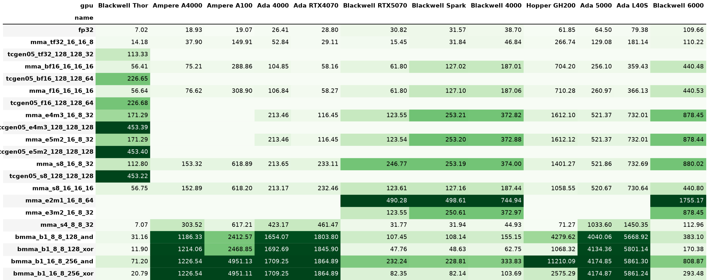
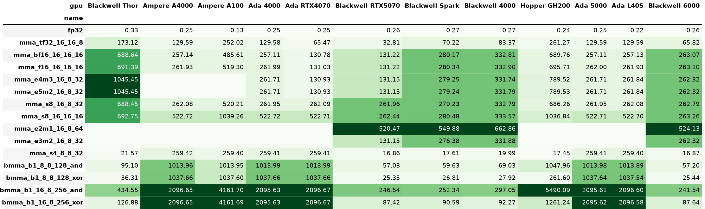
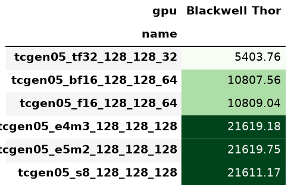

# CUDA peak performance report

This auto-generated report presents benchmark results for the [cudapeak](https://github.com/astron-rd/cudapeak) FP32 and MMA synthetic performance benchmarks on various GPUs.

The benchmarks evaluate synthetic workloads designed to measure peak operations per second (OPs), providing insights into architectural efficiency and computational limits.

## Absolute performance
Measured in teraoperations per second (TOPs), showing raw computational throughput for various data types and MMA sizes.

<b>Data table</b>

<table border="1" class="dataframe">
  <thead>
    <tr style="text-align: right;">
      <th>gpu</th>
      <th>Blackwell Thor</th>
      <th>Ampere A4000</th>
      <th>Ampere A100</th>
      <th>Ada 4000</th>
      <th>Ada RTX4070</th>
      <th>Blackwell RTX5070</th>
      <th>Blackwell Spark</th>
      <th>Blackwell 4000</th>
      <th>Hopper GH200</th>
      <th>Ada 5000</th>
      <th>Ada L40S</th>
      <th>Blackwell 6000</th>
    </tr>
    <tr>
      <th>name</th>
      <th></th>
      <th></th>
      <th></th>
      <th></th>
      <th></th>
      <th></th>
      <th></th>
      <th></th>
      <th></th>
      <th></th>
      <th></th>
      <th></th>
    </tr>
  </thead>
  <tbody>
    <tr>
      <th>fp32</th>
      <td>7.01929</td>
      <td>18.930950</td>
      <td>19.067255</td>
      <td>26.407110</td>
      <td>28.797527</td>
      <td>30.819866</td>
      <td>31.573</td>
      <td>38.7040</td>
      <td>61.853293</td>
      <td>64.498883</td>
      <td>79.3766</td>
      <td>109.655750</td>
    </tr>
    <tr>
      <th>mma_tf32_16_16_8</th>
      <td>14.18200</td>
      <td>37.903967</td>
      <td>149.914518</td>
      <td>52.844960</td>
      <td>29.114508</td>
      <td>15.454058</td>
      <td>31.835</td>
      <td>46.8450</td>
      <td>266.736800</td>
      <td>129.080338</td>
      <td>181.1360</td>
      <td>110.215085</td>
    </tr>
    <tr>
      <th>mma_bf16_16_16_16</th>
      <td>56.41300</td>
      <td>75.212588</td>
      <td>288.862000</td>
      <td>104.852255</td>
      <td>58.160180</td>
      <td>61.804632</td>
      <td>127.024</td>
      <td>187.0130</td>
      <td>704.198000</td>
      <td>256.103896</td>
      <td>359.4260</td>
      <td>440.483894</td>
    </tr>
    <tr>
      <th>mma_f16_16_16_16</th>
      <td>56.63900</td>
      <td>76.615314</td>
      <td>308.900588</td>
      <td>106.844700</td>
      <td>58.274648</td>
      <td>61.802681</td>
      <td>127.099</td>
      <td>187.0590</td>
      <td>710.275867</td>
      <td>260.972078</td>
      <td>366.1300</td>
      <td>440.530013</td>
    </tr>
    <tr>
      <th>mma_e4m3_16_8_32</th>
      <td>171.28700</td>
      <td>0.000000</td>
      <td>0.000000</td>
      <td>213.455950</td>
      <td>116.452746</td>
      <td>123.545516</td>
      <td>253.213</td>
      <td>372.8190</td>
      <td>1612.101333</td>
      <td>521.370130</td>
      <td>732.0090</td>
      <td>878.445664</td>
    </tr>
    <tr>
      <th>mma_e5m2_16_8_32</th>
      <td>171.28700</td>
      <td>0.000000</td>
      <td>0.000000</td>
      <td>213.455950</td>
      <td>116.452617</td>
      <td>123.544432</td>
      <td>253.198</td>
      <td>372.8780</td>
      <td>1612.116000</td>
      <td>521.370130</td>
      <td>732.0150</td>
      <td>878.438458</td>
    </tr>
    <tr>
      <th>mma_s8_16_8_32</th>
      <td>112.79600</td>
      <td>153.317012</td>
      <td>618.888627</td>
      <td>213.654600</td>
      <td>233.112773</td>
      <td>246.765783</td>
      <td>253.189</td>
      <td>374.0010</td>
      <td>1401.265067</td>
      <td>521.855844</td>
      <td>732.6910</td>
      <td>880.022351</td>
    </tr>
    <tr>
      <th>mma_s8_16_16_16</th>
      <td>56.75000</td>
      <td>152.894220</td>
      <td>618.199294</td>
      <td>213.170300</td>
      <td>232.464375</td>
      <td>123.608397</td>
      <td>127.163</td>
      <td>187.4380</td>
      <td>1058.547600</td>
      <td>520.672468</td>
      <td>730.6400</td>
      <td>440.795196</td>
    </tr>
    <tr>
      <th>mma_e2m1_16_8_64</th>
      <td>0.00000</td>
      <td>0.000000</td>
      <td>0.000000</td>
      <td>0.000000</td>
      <td>0.000000</td>
      <td>490.279085</td>
      <td>498.605</td>
      <td>744.9430</td>
      <td>0.000000</td>
      <td>0.000000</td>
      <td>0.0000</td>
      <td>1755.167636</td>
    </tr>
    <tr>
      <th>mma_e3m2_16_8_32</th>
      <td>0.00000</td>
      <td>0.000000</td>
      <td>0.000000</td>
      <td>0.000000</td>
      <td>0.000000</td>
      <td>123.546600</td>
      <td>250.611</td>
      <td>372.9740</td>
      <td>0.000000</td>
      <td>0.000000</td>
      <td>0.0000</td>
      <td>878.454311</td>
    </tr>
    <tr>
      <th>mma_s4_8_8_32</th>
      <td>7.06800</td>
      <td>303.516571</td>
      <td>617.205843</td>
      <td>423.168000</td>
      <td>461.474063</td>
      <td>31.767964</td>
      <td>31.943</td>
      <td>44.9338</td>
      <td>71.268413</td>
      <td>1033.597792</td>
      <td>1450.3500</td>
      <td>112.956561</td>
    </tr>
    <tr>
      <th>bmma_b1_8_8_128_and</th>
      <td>31.16400</td>
      <td>1186.334367</td>
      <td>2412.574510</td>
      <td>1654.073000</td>
      <td>1803.798047</td>
      <td>107.446707</td>
      <td>108.135</td>
      <td>155.1510</td>
      <td>4279.616000</td>
      <td>4040.061039</td>
      <td>5668.9200</td>
      <td>383.101972</td>
    </tr>
    <tr>
      <th>bmma_b1_8_8_128_xor</th>
      <td>11.89700</td>
      <td>1214.064163</td>
      <td>2468.845490</td>
      <td>1692.686500</td>
      <td>1845.898828</td>
      <td>47.764211</td>
      <td>48.629</td>
      <td>62.7494</td>
      <td>1068.321467</td>
      <td>4134.355844</td>
      <td>5801.1400</td>
      <td>170.378837</td>
    </tr>
    <tr>
      <th>bmma_b1_16_8_256_and</th>
      <td>71.19600</td>
      <td>1226.542041</td>
      <td>4951.127451</td>
      <td>1709.245500</td>
      <td>1864.886719</td>
      <td>232.242369</td>
      <td>228.811</td>
      <td>333.8350</td>
      <td>11210.085333</td>
      <td>4174.846753</td>
      <td>5861.3000</td>
      <td>808.865310</td>
    </tr>
    <tr>
      <th>bmma_b1_16_8_256_xor</th>
      <td>20.78800</td>
      <td>1226.542041</td>
      <td>4951.109020</td>
      <td>1709.245500</td>
      <td>1864.886719</td>
      <td>82.348065</td>
      <td>82.140</td>
      <td>103.6910</td>
      <td>2575.290667</td>
      <td>4174.868831</td>
      <td>5861.2400</td>
      <td>293.480101</td>
    </tr>
  </tbody>
</table>

## Operations per SM per clock cycle
Measured in operations per SM per clock cycle, showing how performance scales across different data types.

<b>Data table</b>

<table border="1" class="dataframe">
  <thead>
    <tr style="text-align: right;">
      <th>gpu</th>
      <th>Blackwell Thor</th>
      <th>Ampere A4000</th>
      <th>Ampere A100</th>
      <th>Ada 4000</th>
      <th>Ada RTX4070</th>
      <th>Blackwell RTX5070</th>
      <th>Blackwell Spark</th>
      <th>Blackwell 4000</th>
      <th>Hopper GH200</th>
      <th>Ada 5000</th>
      <th>Ada L40S</th>
      <th>Blackwell 6000</th>
    </tr>
    <tr>
      <th>name</th>
      <th></th>
      <th></th>
      <th></th>
      <th></th>
      <th></th>
      <th></th>
      <th></th>
      <th></th>
      <th></th>
      <th></th>
      <th></th>
      <th></th>
    </tr>
  </thead>
  <tbody>
    <tr>
      <th>fp32</th>
      <td>334.704553</td>
      <td>252.817177</td>
      <td>125.211813</td>
      <td>252.941667</td>
      <td>252.942708</td>
      <td>255.605309</td>
      <td>272.030948</td>
      <td>269.058047</td>
      <td>236.659371</td>
      <td>252.936797</td>
      <td>221.821484</td>
      <td>255.822484</td>
    </tr>
    <tr>
      <th>mma_tf32_16_16_8</th>
      <td>676.250458</td>
      <td>506.196145</td>
      <td>984.466231</td>
      <td>506.177778</td>
      <td>255.726902</td>
      <td>128.168609</td>
      <td>274.288324</td>
      <td>325.651721</td>
      <td>1020.572391</td>
      <td>506.197403</td>
      <td>506.192712</td>
      <td>257.127391</td>
    </tr>
    <tr>
      <th>mma_bf16_16_16_16</th>
      <td>2689.981461</td>
      <td>1004.441610</td>
      <td>1896.913580</td>
      <td>1004.331944</td>
      <td>510.849185</td>
      <td>512.578226</td>
      <td>1094.430659</td>
      <td>1300.055613</td>
      <td>2694.360269</td>
      <td>1004.329004</td>
      <td>1004.432148</td>
      <td>1027.631331</td>
    </tr>
    <tr>
      <th>mma_f16_16_16_16</th>
      <td>2700.757980</td>
      <td>1023.174603</td>
      <td>2028.503994</td>
      <td>1023.416667</td>
      <td>511.854620</td>
      <td>512.562041</td>
      <td>1095.076854</td>
      <td>1300.375391</td>
      <td>2717.615039</td>
      <td>1023.419913</td>
      <td>1023.166778</td>
      <td>1027.738925</td>
    </tr>
    <tr>
      <th>mma_e4m3_16_8_32</th>
      <td>8167.600632</td>
      <td>0.000000</td>
      <td>0.000000</td>
      <td>2044.597222</td>
      <td>1022.861187</td>
      <td>1024.627751</td>
      <td>2181.667011</td>
      <td>2591.720542</td>
      <td>6168.125701</td>
      <td>2044.588745</td>
      <td>2045.632126</td>
      <td>2049.378648</td>
    </tr>
    <tr>
      <th>mma_e5m2_16_8_32</th>
      <td>8167.600632</td>
      <td>0.000000</td>
      <td>0.000000</td>
      <td>2044.597222</td>
      <td>1022.860054</td>
      <td>1024.618760</td>
      <td>2181.537772</td>
      <td>2592.130692</td>
      <td>6168.181818</td>
      <td>2044.588745</td>
      <td>2045.648893</td>
      <td>2049.361837</td>
    </tr>
    <tr>
      <th>mma_s8_16_8_32</th>
      <td>5378.532410</td>
      <td>2047.502834</td>
      <td>4064.149116</td>
      <td>2046.500000</td>
      <td>2047.543025</td>
      <td>2046.558049</td>
      <td>2181.460229</td>
      <td>2599.937435</td>
      <td>5361.436588</td>
      <td>2046.493506</td>
      <td>2047.538006</td>
      <td>2053.056998</td>
    </tr>
    <tr>
      <th>mma_s8_16_16_16</th>
      <td>2706.050873</td>
      <td>2041.856576</td>
      <td>4059.622367</td>
      <td>2041.861111</td>
      <td>2041.847826</td>
      <td>1025.149259</td>
      <td>1095.628274</td>
      <td>1303.010080</td>
      <td>4050.151515</td>
      <td>2041.852814</td>
      <td>2041.806394</td>
      <td>1028.357587</td>
    </tr>
    <tr>
      <th>mma_e2m1_16_8_64</th>
      <td>0.000000</td>
      <td>0.000000</td>
      <td>0.000000</td>
      <td>0.000000</td>
      <td>0.000000</td>
      <td>4066.141562</td>
      <td>4295.948787</td>
      <td>5178.609663</td>
      <td>0.000000</td>
      <td>0.000000</td>
      <td>0.000000</td>
      <td>4094.735993</td>
    </tr>
    <tr>
      <th>mma_e3m2_16_8_32</th>
      <td>0.000000</td>
      <td>0.000000</td>
      <td>0.000000</td>
      <td>0.000000</td>
      <td>0.000000</td>
      <td>1024.636743</td>
      <td>2159.248346</td>
      <td>2592.798054</td>
      <td>0.000000</td>
      <td>0.000000</td>
      <td>0.000000</td>
      <td>2049.398822</td>
    </tr>
    <tr>
      <th>mma_s4_8_8_32</th>
      <td>337.028503</td>
      <td>4053.373016</td>
      <td>4053.098523</td>
      <td>4053.333333</td>
      <td>4053.351449</td>
      <td>263.468386</td>
      <td>275.218845</td>
      <td>312.365659</td>
      <td>272.682941</td>
      <td>4053.324675</td>
      <td>4053.068410</td>
      <td>263.523146</td>
    </tr>
    <tr>
      <th>bmma_b1_8_8_128_and</th>
      <td>1486.015320</td>
      <td>15843.140590</td>
      <td>15843.016219</td>
      <td>15843.611111</td>
      <td>15843.636775</td>
      <td>891.111890</td>
      <td>931.684243</td>
      <td>1078.561001</td>
      <td>16374.410774</td>
      <td>15843.376623</td>
      <td>15842.052314</td>
      <td>893.761600</td>
    </tr>
    <tr>
      <th>bmma_b1_8_8_128_xor</th>
      <td>567.293167</td>
      <td>16213.463719</td>
      <td>16212.539337</td>
      <td>16213.472222</td>
      <td>16213.428442</td>
      <td>396.133650</td>
      <td>418.984353</td>
      <td>436.214112</td>
      <td>4087.547699</td>
      <td>16213.160173</td>
      <td>16211.547060</td>
      <td>397.487022</td>
    </tr>
    <tr>
      <th>bmma_b1_16_8_256_and</th>
      <td>3394.889832</td>
      <td>16380.102041</td>
      <td>32513.313968</td>
      <td>16372.083333</td>
      <td>16380.208333</td>
      <td>1926.107754</td>
      <td>1971.420940</td>
      <td>2320.716024</td>
      <td>42891.358025</td>
      <td>16371.948052</td>
      <td>16379.666890</td>
      <td>1887.050461</td>
    </tr>
    <tr>
      <th>bmma_b1_16_8_256_xor</th>
      <td>991.249084</td>
      <td>16380.102041</td>
      <td>32513.192931</td>
      <td>16372.083333</td>
      <td>16380.208333</td>
      <td>682.955690</td>
      <td>707.712986</td>
      <td>720.827251</td>
      <td>9853.423120</td>
      <td>16372.034632</td>
      <td>16379.499218</td>
      <td>684.677354</td>
    </tr>
  </tbody>
</table>

## tcgen05 absolute performance
Measured in teraoperations per second (TOPs) for tcgen05 (UMMA) kernels. On Thor these kernels reach a much higher peak throughput than the warp-level kernels above.

<b>Data table</b>

<table border="1" class="dataframe">
  <thead>
    <tr style="text-align: right;">
      <th>gpu</th>
      <th>Blackwell Thor</th>
    </tr>
    <tr>
      <th>name</th>
      <th></th>
    </tr>
  </thead>
  <tbody>
    <tr>
      <th>tcgen05_tf32_128_128_32</th>
      <td>113.325</td>
    </tr>
    <tr>
      <th>tcgen05_bf16_128_128_64</th>
      <td>226.651</td>
    </tr>
    <tr>
      <th>tcgen05_f16_128_128_64</th>
      <td>226.682</td>
    </tr>
    <tr>
      <th>tcgen05_e4m3_128_128_128</th>
      <td>453.387</td>
    </tr>
    <tr>
      <th>tcgen05_e5m2_128_128_128</th>
      <td>453.399</td>
    </tr>
    <tr>
      <th>tcgen05_s8_128_128_128</th>
      <td>453.219</td>
    </tr>
  </tbody>
</table>

## tcgen05 operations per SM per clock cycle
Measured in operations per SM per clock cycle for tcgen05 (UMMA) kernels.

<b>Data table</b>

<table border="1" class="dataframe">
  <thead>
    <tr style="text-align: right;">
      <th>gpu</th>
      <th>Blackwell Thor</th>
    </tr>
    <tr>
      <th>name</th>
      <th></th>
    </tr>
  </thead>
  <tbody>
    <tr>
      <th>tcgen05_tf32_128_128_32</th>
      <td>5403.757095</td>
    </tr>
    <tr>
      <th>tcgen05_bf16_128_128_64</th>
      <td>10807.561874</td>
    </tr>
    <tr>
      <th>tcgen05_f16_128_128_64</th>
      <td>10809.040070</td>
    </tr>
    <tr>
      <th>tcgen05_e4m3_128_128_128</th>
      <td>21619.176865</td>
    </tr>
    <tr>
      <th>tcgen05_e5m2_128_128_128</th>
      <td>21619.749069</td>
    </tr>
    <tr>
      <th>tcgen05_s8_128_128_128</th>
      <td>21611.166000</td>
    </tr>
  </tbody>
</table>

*Report generated on 2026-11-20 10:52 UTC*
